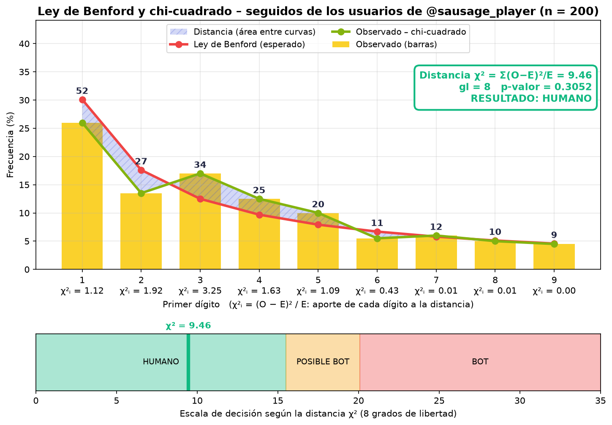

# Instagram Profile & Post Scraper con Playwright

## Descripción

Script desarrollado en Python que utiliza **Playwright** para extraer información visible de un perfil de Instagram, recopilar enlaces de publicaciones y reels, realizar un scraping detallado de cada post (texto, likes, comentarios y fecha), y guardar todos los resultados estructurados en un archivo JSON.

Después, la biografía y los textos de las publicaciones se envían a la **API de Gemini**, que estima la personalidad de la cuenta según el modelo de los **Cinco Grandes (Big Five / OCEAN)**. Con ese resultado se genera un **informe en PDF**.

Finalmente, el programa recolecta una muestra de los **seguidores del perfil** (cuántos seguidores y seguidos tiene cada uno) y aplica la **Ley de Benford** con la prueba **chi-cuadrado** para evaluar si ese conjunto de cuentas se comporta como el de usuarios reales o resulta sospechoso de ser bots. El resultado se guarda en una gráfica PNG y en una hoja de Excel.

> Los informes son estimaciones automáticas y orientativas. El análisis Big Five no constituye una evaluación psicológica profesional y el resultado de Benford es un indicio, no una prueba definitiva de que una cuenta sea un bot.

---

## Características

* **Datos de Perfil:** Extrae nombre, biografía, seguidores y seguidos.
* **Scraping de Publicaciones:** Visita cada post/reel para extraer su texto (caption), cantidad de likes, comentarios y fecha.
* **Prevención de Duplicados:** Evita procesar enlaces repetidos durante el desplazamiento (*scroll*).
* **Autenticación Segura:** Utiliza cookies externas independientes del código principal.
* **Análisis Big Five con Gemini:** puntuación de 0 a 100 y explicación para apertura, responsabilidad, extroversión, amabilidad y neuroticismo, más un resumen psicológico.
* **Tolerancia a fallos de la API:** reintentos con espera creciente ante errores 429/500/502/503/504 y cambio automático a un modelo de respaldo.
* **Informe PDF:** cabecera del perfil, barras de puntuación por rasgo y resumen.
* **Recolección de seguidores:** abre la lista de seguidores y, pasando el cursor sobre cada usuario, lee de su tarjeta emergente la cantidad de seguidores y seguidos (200 usuarios por defecto).
* **Reanudación:** guarda el avance después de cada usuario; si la ejecución se interrumpe, continúa donde quedó.
* **Ley de Benford y chi-cuadrado:** compara la distribución del primer dígito de los seguidos con la esperada, calcula χ² y el p-valor, y clasifica el resultado como *Humano*, *Posible bot* o *Bot*.
* **Gráfica y tabla de resultados:** imagen PNG con las barras observadas, la curva de Benford y la escala de decisión, y una tabla con el detalle dentro del Excel.
* **Exportación JSON y Excel:** Guarda toda la información de manera ordenada en archivos JSON y en una hoja de cálculo (`.xlsx`).

---

## Requisitos

* Python 3.10 o superior
* Playwright
* google-genai (SDK de Gemini)
* ReportLab
* Matplotlib
* openpyxl
* Una cuenta de Instagram con sesión iniciada y una clave de API de Gemini

---

## Instalación

1. Clona el repositorio o descarga los archivos del proyecto.
2. Instala las dependencias necesarias mediante el archivo `requirements.txt`:
    ```bash
    pip install -r requirements.txt
    ```

3. Instala el navegador Chromium necesario para Playwright:
    ```bash
    playwright install chromium
    ```

---

## Configuración

### 1. Configurar las Cookies (Importante)
> **Nota:** Este programa permite el uso de cookies configuradas manualmente o mediante una extensión del navegador.
Para evitar bloqueos de inicio de sesión, el script requiere cookies válidas:
1. Crea un archivo llamado `cookies.json` en la raíz del proyecto (puedes guiarte de la estructura de `cookiesEjemplo.json`).
2. Exporta tus cookies de sesión de Instagram desde el navegador y pégalas en el archivo `cookies.json`.

> **Advertencia de Seguridad:** Nunca subas tu archivo `cookies.json` a GitHub ni lo compartas públicamente, ya que contiene acceso directo a tu cuenta. El proyecto cuenta con un archivo `.gitignore` para protegerlo automáticamente.

### 2. Clave de API de Gemini
1. Ingresa a [Google AI Studio](https://aistudio.google.com/apikey) con tu cuenta de Google y crea una clave (*Create API key*).
2. Crea un archivo `apiKey.txt` en la raíz del proyecto y pega la clave sola, sin comillas ni espacios.

### 3. Parámetros del Script
Abre el archivo `scraper.py` y ajusta el usuario que deseas analizar y el límite de publicaciones:
```python
USERNAME = "nombre_de_usuario"
MAX_POSTS = 10
```
Opcionalmente, puedes cambiar los modelos de Gemini (el primero es el preferido y el resto, respaldo) y los reintentos por modelo:

```python
MODELOS_GEMINI = ["gemini-3.5-flash", "gemini-3.1-flash-lite"]
REINTENTOS_POR_MODELO = 4
```

Para el análisis de Benford, el archivo `recolector_seguidores.py` define cuántos usuarios de la lista de seguidores se recolectan:

```python
TOTAL_USUARIOS = 200
```
Con menos de 50 usuarios el resultado no es confiable. Este número forma parte del nombre de los archivos generados (por ejemplo, `usuario_usuarios_200.json`).

---

## Ejecución

Ejecuta el script en tu terminal con el siguiente comando. Realiza todo el proceso: scraping del perfil, análisis Big Five, recolección de seguidores y Ley de Benford.
```bash
python scraper.py
```

Se abrirá una ventana de Chromium que no debes cerrar mientras el programa trabaja. La terminal mostrará el avance (por ejemplo, `[1/200] @usuario  seguidores=184  seguidos=312`) y, al final, la tabla de dígitos, el valor de χ² y el resultado.

Cada parte también puede ejecutarse por separado:
```bash
python recolector_seguidores.py [usuario]   # recolecta seguidores y seguidos (abre su propio navegador)
python benford.py [archivo.json]            # aplica Benford a un archivo de usuarios ya recolectado
```
Si no indicas el usuario o el archivo, se usa el `USERNAME` definido en `scraper.py`. Si el archivo de usuarios ya está completo, `recolector_seguidores.py` solo regenera los archivos, sin abrir el navegador. Si `benford.py` avisa que no pudo guardar el Excel, ciérralo y vuelve a ejecutarlo.

---

## Archivos generados

| Archivo | Contenido |
| --- | --- |
| `usuario_instagram.json` | Perfil (usuario, nombre, seguidores, seguidos, biografía) y publicaciones (enlace, tipo, texto, likes, comentarios, fecha). |
| `usuario_bigfive.pdf` | Informe Big Five: resumen del perfil, una barra de 0 a 100 con explicación por rasgo y resumen psicológico. |
| `usuario_usuarios_200.json` | Usuario, seguidores y seguidos de cada cuenta recolectada de la lista de seguidores. |
| `usuario_usuarios_200.xlsx` | Hoja *Usuarios*: columnas A a C con los datos recolectados y, desde la columna E, la tabla de Benford y chi-cuadrado. |
| `benford_usuario.png` | Gráfica de Benford: barras observadas, curva esperada, área de distancia, χ², p-valor, resultado y escala de decisión. |

> Los archivos `usuario_usuarios_200.json` y `.xlsx` contienen nombres de usuario de terceros. Tenlo en cuenta antes de compartirlos o subirlos a un repositorio público.

---

## Ley de Benford

En muchos conjuntos de cantidades reales el primer dígito no se reparte por igual: el 1 aparece cerca del 30 % de las veces y el 9 menos del 5 %. La probabilidad de que el primer dígito sea *d* es:

```
P(d) = log10(1 + 1/d)
```

El programa toma la cantidad de **seguidos** de cada usuario recolectado (ignorando los ceros), cuenta su primer dígito y mide la distancia con la distribución esperada mediante chi-cuadrado:

```
χ² = Σ (O − E)² / E        (9 dígitos → 8 grados de libertad)
```

| Resultado | Condición |
| --- | --- |
| **Humano** | χ² ≤ 15.507 (no significativo al 5 %) |
| **Posible bot** | 15.507 < χ² ≤ 20.090 (significativo al 5 %, no al 1 %) |
| **Bot** | χ² > 20.090 (significativo al 1 %) |

### Ejemplo de resultado

Con los 200 usuarios recolectados del perfil `sausage_player` el resultado fue **HUMANO** (χ² = 9.46, 8 grados de libertad, p-valor = 0.3052).

| Primer dígito | Conteo | Observado % | Benford % | (O − E)² / E |
| --- | --- | --- | --- | --- |
| 1 | 52 | 26.0 | 30.1 | 1.12 |
| 2 | 27 | 13.5 | 17.6 | 1.92 |
| 3 | 34 | 17.0 | 12.5 | 3.25 |
| 4 | 25 | 12.5 | 9.7 | 1.63 |
| 5 | 20 | 10.0 | 7.9 | 1.09 |
| 6 | 11 | 5.5 | 6.7 | 0.43 |
| 7 | 12 | 6.0 | 5.8 | 0.01 |
| 8 | 10 | 5.0 | 5.1 | 0.01 |
| 9 | 9 | 4.5 | 4.6 | 0.00 |



---

## Estructura del proyecto

* `scraper.py`: programa principal (perfil, publicaciones, Big Five y orquestación del resto).
* `pdf_bigfive.py`: genera el informe PDF con ReportLab.
* `recolector_seguidores.py`: recolecta seguidores y seguidos de la lista de seguidores y guarda JSON y Excel.
* `benford.py`: aplica la Ley de Benford y chi-cuadrado, genera la gráfica y agrega la tabla al Excel.
* `cookiesEjemplo.json`: ejemplo del formato de `cookies.json`.
* `requirements.txt`: dependencias del proyecto.

---

## Tecnologías Utilizadas
1. Python
2. Playwright
3. JSON
4. API de Gemini (`google-genai`)
5. ReportLab
6. Matplotlib
7. openpyxl (Excel)
8. Ley de Benford y prueba chi-cuadrado

----